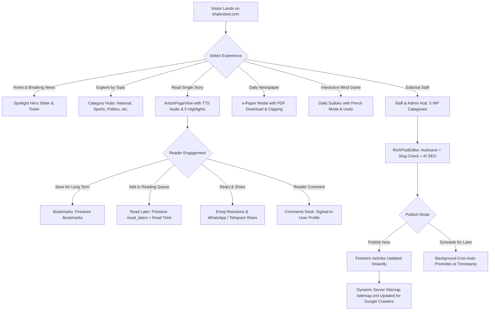

# Khabri Dost (ख़बरी दोस्त) — Complete Technical Audit, Sitemap, Admin Panel Structure & Architectural Mind Map

**Official Brand Name:** Khabri Dost  
**Official Production Domain:** `https://khabridost.com`  
**Application Platform:** Vite 8.3 + React 19 + TypeScript 7.0 + Tailwind CSS v4 + Express 4.21 + Firebase Firestore & Auth  
**Current Audit Date:** October 2026  
**Status:** Audit Completed & Core Upgrades (Brand Consistency, Settings Sync, Dynamic Sitemap, Media Sync, and Read Later Feature) Implemented & Verified  

---

## Table of Contents
1. [Executive Summary & Recent Implementation Changelog](#1-executive-summary--recent-implementation-changelog)
2. [Complete Website Sitemap Structure (Visual & Routes)](#2-complete-website-sitemap-structure)
3. [Complete Admin Panel Structure (WordPress 5-Category Architecture)](#3-complete-admin-panel-structure)
4. [Master Website Mind Map (ASCII & Architecture Diagrams)](#4-master-website-mind-map)
5. [How the Website Structure Works (Deep Dive)](#5-how-the-website-structure-works)
   * 5.1 [Font & Typography System (Mukta, Hind, Rozha One)](#51-font--typography-system)
   * 5.2 [Categories & Regional Taxonomy Engine](#52-categories--regional-taxonomy-engine)
   * 5.3 [Editorial Post Publishing & Revision Pipeline](#53-editorial-post-publishing--revision-pipeline)
   * 5.4 ['Read Later' Feature vs 'Bookmarks' System](#54-read-later-feature-vs-bookmarks-system)
   * 5.5 [Media Library, WebP Compression & Cloud Storage](#55-media-library-webp-compression--cloud-storage)
   * 5.6 [Technical SEO, Schema.org & Dynamic XML Sitemap](#56-technical-seo-schemaorg--dynamic-xml-sitemap)
   * 5.7 [Security Hardening & Server-Side RBAC](#57-security-hardening--server-side-rbac)

---

## 1. Executive Summary & Recent Implementation Changelog

| Milestone | Target | Description | Verified Status |
|---|---|---|---|
| **Brand Standardization** | 19 Files | Eliminated all occurrences of misspelled "Khabari" across user-facing templates, canonical URLs, meta tags, and export files. Retained dual auth email compatibility (`khabridost.com@gmail.com` and `khabaridost.com@gmail.com`). | **COMPLETED ✓** |
| **Cloud Settings Sync** | Firestore `/settings/portal_config` | Portal customization (typography, layout toggles, header/footer, ad slots) now syncs to Firestore database in real-time, removing reliance on browser local storage only. | **COMPLETED ✓** |
| **5-Category WordPress Admin** | `AdminBackendPanel.tsx` | Consolidated 20 disjointed tabs into 5 streamlined WordPress-style sections (`Dashboard`, `News & Content`, `Media Library`, `Appearance & Customization`, `Settings & SEO`) with automated submenu expansion. | **COMPLETED ✓** |
| **Dynamic Server Sitemap** | Express `GET /sitemap.xml` | Server-side UTF-8 XML sitemap generation with Google News schema (`xmlns:news`), real-time article indexing, and crawler directives in `/robots.txt`. | **COMPLETED ✓** |
| **Cloud Media Library** | Firestore `/media` | Multi-device media asset synchronization with client-side WebP compression and instant newsroom sharing. | **COMPLETED ✓** |
| **Live Blogs Persistence** | Firestore `/live_blogs` | Real-time coverage timelines for elections and cricket with Firestore security rules and updates. | **COMPLETED ✓** |
| **'Read Later' Feature** | Firestore `/read_laters` & UI | Dedicated reader queue separate from bookmarks. Full Firestore collection, private security rules, reading time estimate, category filters, and local profile fallback. | **COMPLETED ✓** |

---

## 2. Complete Website Sitemap Structure

### 2.1 Public Reader URL & Route Hierarchy

```
https://khabridost.com/
├── / (Home / ताज़ा ख़बरें)
│   ├── #top-stories (मुख्य समाचार - Hero Slider + 4 Secondary Cards)
│   ├── #breaking-ticker (लाइव ब्रेकिंग न्यूज़ टिकर)
│   ├── #video-bulletins (वीडियो बुलेटिन एवं लाइव टीवी)
│   ├── #photo-gallery (फोटो स्टोरीज़ एवं विजुअल गैलरी)
│   ├── #quick-briefs (संक्षिप्त समाचार एवं सुर्खियां)
│   ├── #opinion-poll (जनमत सर्वेक्षण)
│   └── #sudoku (दैनिक सुडोकू पहेली - पेंसिल मोड व Undo)
│
├── /category/{category_slug} (Category News Hubs)
│   ├── /national (देश / भारत)
│   ├── /state (राज्य / प्रादेशिक समाचार)
│   │   ├── ?region=north (उत्तर भारत: UP, बिहार, दिल्ली, MP, राजस्थान, पंजाब, हरियाणा)
│   │   ├── ?region=south (दक्षिण भारत: कर्नाटक, तमिलनाडु, तेलंगाना, केरल, AP)
│   │   ├── ?region=west (पश्चिम भारत: महाराष्ट्र, गुजरात, गोवा)
│   │   ├── ?region=east (पूर्व भारत: पश्चिम बंगाल, ओडिशा, झारखंड)
│   │   └── ?region=northeast (पूर्वोत्तर भारत: असम, त्रिपुरा, मणिपुर, मेघालय)
│   ├── /politics (राजनीति व चुनाव)
│   ├── /business (कारोबार, शेयर बाजार, बजट)
│   ├── /technology (टेक, ऑटोमोबाइल, गैजेट्स)
│   ├── /entertainment (मनोरंजन, बॉलीवुड, ओटीटी)
│   ├── /sports (खेल, क्रिकेट, ओलंपिक)
│   ├── /lifestyle (लाइफस्टाइल, स्वास्थ्य, खान-पान)
│   ├── /factcheck (तथ्य जांच / फेक न्यूज़ पड़ताल)
│   ├── /astro (राशिफल, ज्योतिष व पंचांग)
│   └── /opinion (संपादकीय, विचार व विश्लेषण)
│
├── /article/{category}/{slug_id} (Full Reading UX View)
│   ├── Breadcrumb navigation (/category/slug)
│   ├── Listen to Story (Web Speech TTS Audio Player with Soundwave)
│   ├── 5 Key Highlights (मुख्य बिंदु बुलेट पॉइंट्स)
│   ├── Verified Reporter / Editorial byline & location tag
│   ├── Rich editorial content with embedded images & blockquotes
│   ├── Reader Reaction Bar (लाइक, विचार, इमोजी)
│   ├── Reader Comments Desk (Verified Google sign-in)
│   ├── Related News Feed (3–6 context-aware stories)
│   └── Social share drawer (WhatsApp, Telegram, Facebook, X, WebShare)
│
├── /live-feed (#live-feed / पल-पल की लाइव कवरेज)
│   ├── Live timeline events with instant timestamping
│   ├── Critical / Breaking alert badges
│   └── Real-time polling synchronization
│
├── /epaper (#epaper / डिजिटल ई-पेपर)
│   ├── Newspaper edition page view
│   ├── Multi-page navigation (पृष्ठ 1, पृष्ठ 2...)
│   ├── Article clipping tool (Crop & Share screenshot)
│   └── Download Full Page PDF (A4 / Broadside via jsPDF)
│
├── /archive (#archive / समाचार पुरालेख)
│   ├── Date picker calendar filter
│   ├── Category-wise historical news lookup
│   └── Chronological pagination
│
├── /submit-news (#submit-news / नागरिक पत्रकारिता Desk)
│   ├── Citizen reporter news submission form
│   ├── Image attachment & video link field
│   └── Verified contact disclosure
│
├── /contact (#contact / संपर्क एवं संपादकीय केंद्र)
│   ├── Editorial grievance officer details (IT Rules compliant)
│   ├── Bureau office addresses & telephone lines
│   └── Real-time reader inquiry form (synced to Firestore `/inquiries`)
│
├── /about (#about / हमारे बारे में)
│   ├── Mission, Code of Ethics, Fact-checking policy
│   └── Editorial Board & Leadership team profiles
│
├── /legal (कानूनी नीतियां व अनुपालन)
│   ├── /privacy-policy (गोपनीयता नीति - DPDP Act 2023 compliant)
│   ├── /terms-of-service (नियम व शर्तें)
│   ├── /editorial-guidelines (संपादकीय आचार संहिता)
│   ├── /grievance-redressal (शिकायत निवारण प्रक्रिया)
│   └── /cookie-policy (कुकी व डेटा नीति)
│
└── Reader Profile Modals & Overlays
    ├── [Bookmark Modal] (सहेजी गई ख़बरें - Persistent Firestore Bookmarks)
    ├── [Read Later Modal] (बाद में पढ़ें - Personal Queue with Read Time Estimates)
    ├── [Daily Sudoku Modal] (दैनिक सुडोकू पहेली)
    ├── [Typography Customizer] (फ़ॉन्ट व लिखावट आकार समायोजन)
    └── [Newsletter Modal] (निःशुल्क न्यूज़ अलर्ट्स सदस्यता)
```

### 2.2 Server-Side Dynamic XML Sitemaps & Crawler Endpoints

```
https://khabridost.com/
├── /sitemap.xml (Dynamic master XML sitemap index & live article feed)
│   ├── Standard XML schema: http://www.sitemaps.org/schemas/sitemap/0.9
│   ├── Google News schema: http://www.google.com/schemas/sitemap-news/0.9
│   │   ├── <news:publication> (Name: Khabri Dost, Language: hi)
│   │   ├── <news:publication_date> (W3C ISO timestamp)
│   │   ├── <news:title> (Headline in Hindi UTF-8)
│   │   └── <news:keywords> (Category, tags, location)
│   ├── Image namespace: http://www.google.com/schemas/sitemap-image/1.1
│   └── Changefreq: hourly (breaking), daily (categories), weekly (static)
│
├── /robots.txt (Crawler directives)
│   ├── User-agent: *
│   ├── Allow: /
│   ├── Disallow: /api/
│   ├── Disallow: /admin
│   └── Sitemap: https://khabridost.com/sitemap.xml
│
└── /api/* (Backend Express REST Proxy Endpoints)
    ├── GET  /api/health (Server status check)
    ├── POST /api/gemini/generate (AI Headline, SEO & Fact-Check Proxy)
    ├── POST /api/contact/submit (Inquiry submission backup)
    └── POST /api/citizen-news/submit (Citizen journalism submission handler)
```

---

## 3. Complete Admin Panel Structure

The Khabri Dost editorial admin suite (`AdminBackendPanel.tsx`) is structured according to **5 Core WordPress-standard categories**, eliminating cognitive overload and providing editorial staff with clean, role-gated workflows.

```
👑 Khabri Dost Editorial Management Studio (Admin Hub)
├── 1. DASHBOARD (डैशबोर्ड एवं मेट्रिक्स)
│   ├── 1.1 Dashboard Overview (मुख्य अवलोकन)
│   │   ├── Daily News Metrics (Total Articles, Views, Likes, Comments)
│   │   ├── Active Editorial Staff Count & Server Status
│   │   ├── Quick Post Draft Widget (शीघ्र प्रारूप)
│   │   └── Recent Published News Stream with Edit / Delete actions
│   └── 1.2 System Speed & Web Vitals (वेब वाइटल्स व प्रदर्शन)
│       ├── Real-time Core Web Vitals (LCP, FID, CLS scores)
│       ├── Client-side memory & caching audit
│       └── Database latency and query round-trip check
│
├── 2. NEWS & CONTENT (समाचार एवं संपादकीय सामग्री)
│   ├── 2.1 All News Articles (सभी समाचार - CMS Post Grid)
│   │   ├── Filter by Category, Publish Status (Published, Draft, Scheduled)
│   │   ├── Search by Headline, Author, or Keyword
│   │   └── Bulk Actions: Multi-delete, Status toggle, CSV/JSON Export
│   ├── 2.2 Add New Article (नया समाचार जोड़ें - RichPostEditorModal)
│   │   ├── Headline, Summary, Category, Author, Location input
│   │   ├── Rich Text Formatting: H2, H3, Bold, Italic, Quotes, Bullet lists
│   │   ├── Featured Image Uploader with Instant WebP Compression
│   │   ├── 5 Key Highlights auto-extractor & manual editor
│   │   ├── Slug Collision Detector (with 1-Click Auto-Fix suffix)
│   │   ├── Autosave Draft Recovery (LocalStorage backup restoration)
│   │   └── Publishing Mode: Publish Now vs Scheduled DateTime Picker
│   ├── 2.3 Citizen Desk (नागरिक पत्रकारिता)
│   │   ├── Reader submissions review queue
│   │   ├── Fact-check verification badge
│   │   └── 1-Click Promote to Official Editorial Post
│   ├── 2.4 Live Coverage (लाइव ब्लॉग एवं चुनाव ट्रैकर)
│   │   ├── Create Live Event (Election, Cricket match, Breaking Crisis)
│   │   ├── Add live updates with real-time timestamping
│   │   └── Direct Firestore `/live_blogs` synchronization
│   ├── 2.5 Trending & Tickers (ट्रेंडिंग कीवर्ड्स व टिकर)
│   │   ├── Breaking ticker speed (Slow, Normal, Fast)
│   │   ├── Pinned trending topics management
│   │   └── Live search trends integration
│   ├── 2.6 E-Paper Edition (ई-पेपर संस्करण)
│   │   ├── Upload daily digital PDF edition
│   │   ├── Multi-page preview setup
│   │   └── Clipping tool settings
│   └── 2.7 AI SEO Assistant (एआई एसईओ सहायक - Gemini 2.5)
│       ├── 1-Click Headline optimization in Devanagari
│       ├── Automatic Meta Description generator (under 160 characters)
│       └── Trending tags and focus keyword suggestions
│
├── 3. MEDIA LIBRARY (मीडिया एवं गैलरी प्रबंधन)
│   ├── 3.1 Media Library & WebP (मीडिया लाइब्रेरी)
│   │   ├── Grid view of all newsroom media assets
│   │   ├── Client-side WebP compressor (converts 5MB JPGs to <100KB WebP)
│   │   ├── Alt text & caption editor for image SEO
│   │   └── Direct sync to Firestore `/media` collection
│   ├── 3.2 Video Bulletin & Reels (वीडियो बुलेटिन)
│   │   ├── 24x7 Live TV Stream setup (Official DD News Hindi default)
│   │   ├── YouTube video news playlist manager
│   │   └── Video title, duration, and thumbnail editor
│   └── 3.3 Photo Stories & Gallery (फोटो स्टोरीज़)
│       ├── High-resolution photo gallery manager
│       ├── Image credits, location tags, and descriptions
│       └── Visual carousel ordering
│
├── 4. APPEARANCE & CUSTOMIZATION (दिखावट एवं लेआउट अनुकूलन)
│   ├── 4.1 Homepage Sections & Grid (होमपेज लेआउट)
│   │   ├── Section toggles: Spotlight, Breaking, Videos, Photos, Opinion
│   │   └── 1-to-5 order priority adjustment
│   ├── 4.2 Top Stories Spotlight (स्पॉटलाइट सेटिंग्स)
│   │   ├── Hero Slider vs Static Big Card mode toggle
│   │   ├── Slide transition speed (3s, 5s, 8s) & autoplay
│   │   └── Secondary featured cards count selector
│   ├── 4.3 Header & Navigation (हेडर व नेविगेशन)
│   │   ├── Custom Logo Uploader & Height adjustment slider (40px–90px)
│   │   ├── Site Title, Hindi Tagline, Date & Weather display toggles
│   │   ├── Quick access buttons (Live TV, e-Paper, Bookmarks, Read Later, Sudoku)
│   │   └── Sticky header enable / disable toggle
│   ├── 4.4 Footer & About (फुटर एवं कानूनी कड़ियां)
│   │   ├── Editorial bio and about text
│   │   ├── Grievance officer email & phone display
│   │   ├── Social channel links (WhatsApp, Telegram, FB, X, Insta, YT)
│   │   └── Copyright & DMCA compliance notice
│   ├── 4.5 Sidebar Widgets & Rashi (साइडबार विजेट्स)
│   │   ├── Daily Rashi (दैनिक राशिफल - 12 Signs)
│   │   ├── Weather forecast widget
│   │   ├── Live Poll widget (प्रश्नोत्तरी)
│   │   └── Most Read / Trending stories list
│   ├── 4.6 Sidebar Ad Slots (विज्ञापन प्रबंधन)
│   │   ├── Header Leaderboard (728x90)
│   │   ├── Sidebar Rectangle (300x250, 300x600)
│   │   ├── In-Article Banner (Responsive)
│   │   └── AdSense client code or direct image banner insertion
│   ├── 4.7 Article Layout & Meta (लेख दृश्य अनुकूलन)
│   │   ├── Show/hide Author byline, reading time, view count, comments
│   │   ├── Compact single-line action bar vs multi-line
│   │   └── Social sharing buttons visibility
│   ├── 4.8 Mobile Drawer Menu (मोबाइल साइडबार मेनू)
│   │   ├── Categories display (2 columns vs 1 column)
│   │   ├── Quick utility buttons (Bookmarks, Read Later, Archive, Sudoku)
│   │   └── Social media circular badges
│   └── 4.9 Typography & Hindi Fonts (फ़ॉन्ट व लिखावट सेटिंग्स)
│       ├── Heading Font Selector (Rozha One, Mukta, Hind)
│       ├── Body Font Selector (Mukta, Hind, Noto Sans Devanagari)
│       ├── Font size scaling (+/- 4px across 3 presets)
│       ├── Line-height ratio slider (1.5x–1.9x)
│       └── Real-time interactive preview card
│
└── 5. SETTINGS & SEO (पोर्टल सेटिंग्स, एसईओ व सुरक्षा)
    ├── 5.1 General & Site Identity (सामान्य सेटिंग्स)
    │   ├── Portal Name: Khabri Dost (ख़बरी दोस्त)
    │   ├── Tagline: भारत का विश्वसनीय हिंदी न्यूज़ पोर्टल
    │   ├── Default Language: hi (Hindi) & Timezone: Asia/Kolkata
    │   └── One-Click Factory Reset (Restore defaults while preserving API keys)
    ├── 5.2 SEO Audit & XML Sitemap (एसईओ एवं साइटमैप)
    │   ├── Server-Side XML Sitemap inspect link (`/sitemap.xml`)
    │   ├── OpenGraph & Twitter Card tags preview
    │   └── Schema.org JSON-LD validator (NewsArticle, Organization, WebSite)
    ├── 5.3 Google Suite & Analytics (गूगल सेवाएं)
    │   ├── Google Analytics 4 (GA4) Measurement ID (`G-XXXXXXXXXX`)
    │   ├── Google Tag Manager (GTM) Container ID (`GTM-XXXXXXX`)
    │   ├── Google Search Console HTML verification meta tag
    │   └── Google AdSense Publisher ID (`ca-pub-XXXXXXXXXXXXXXXX`)
    ├── 5.4 Monetization & AdSense (मुद्रीकरण सेटिंग्स)
    │   ├── Global Ad toggles (Top, Middle, Bottom, Sidebar)
    │   └── Custom sponsored banner campaigns
    ├── 5.5 Contact Inquiries (पाठक पूछताछ डेस्क)
    │   ├── Inquiries queue synced to Firestore `/inquiries`
    │   ├── Status tracking: `new`, `in-review`, `resolved`
    │   └── Admin internal notes and CSV export
    ├── 5.6 Contact Details (संपर्क जानकारी)
    │   ├── Official email addresses & phone numbers
    │   └── Physical bureau address in New Delhi
    ├── 5.7 Social & WhatsApp (सोशल मीडिया चैनल्स)
    │   ├── Official WhatsApp Channel & Group link
    │   └── Telegram channel link for breaking bulletins
    ├── 5.8 Policies & Legal (कानूनी नीतियां)
    │   ├── DPDP Act 2023 compliant Privacy Policy
    │   ├── Terms of Service & Disclaimer
    │   └── Editorial Ethics & Grievance Redressal
    ├── 5.9 Editorial Staff & Roles (स्टाफ व अनुमतियां)
    │   ├── Role-Based Access Control (Super Admin, Admin, Editor, Reporter, Reader)
    │   └── One-click verified staff credentials
    ├── 5.10 Administrator Access (व्यवस्थापक पहुंच)
    │   ├── Server-verified Super Admin email registry
    │   └── Privilege escalation defense audit
    ├── 5.11 Subscribers & VIPs (सब्सक्राइबर्स सूची)
    │   ├── Newsletter email subscriber registry
    │   └── CSV export for email campaign delivery
    ├── 5.12 Push Notifications (पुश नोटिफिकेशन)
    │   ├── Send breaking news notification toast to active readers
    │   └── Notification history and click statistics
    ├── 5.13 Popups & Alerts (वेबसाइट पॉपअप्स)
    │   ├── Breaking alert banner configuration
    │   └── Subscriber capture modal timing
    └── 5.14 API Keys & Cloud Providers (क्लाउड व एआई कुंजियां)
        ├── Gemini API Server-Side Key configuration
        └── Firebase project credentials status check
```

---

## 4. Master Website Mind Map

### 4.1 High-Level Architectural Mind Map

```
                     ╔════════════════════════════════════════════════════╗
                     ║               KHABRI DOST PORTAL                   ║
                     ║       (https://khabridost.com • Hindi News)        ║
                     ╚════════════════════════════════════════════════════╝
                                                │
         ┌───────────────────┬──────────────────┴──────────────────┬───────────────────┐
         │                   │                                     │                   │
         ▼                   ▼                                     ▼                   ▼
┌─────────────────┐ ┌─────────────────┐                   ┌─────────────────┐ ┌─────────────────┐
│  READER FRONTEND│ │  CMS NEWSROOM   │                   │  DATA & STORAGE │ │ SERVER & APIS   │
│ (React 19+Vite) │ │  (Admin Studio) │                   │  (Cloud+Local)  │ │ (Express Node)  │
└────────┬────────┘ └────────┬────────┘                   └────────┬────────┘ └────────┬────────┘
         │                   │                                     │                   │
         ├─ Header & Nav     ├─ 5 WP Categories                   ├─ Firestore Articles ├─ GET /sitemap.xml
         ├─ Hero Slider      ├─ Rich Post Editor                  ├─ Firestore Comments ├─ Rate Limiter
         ├─ Category Hubs    ├─ Autosave Drafts                   ├─ Firestore Bookmarks├─ OWASP Headers
         ├─ Single Article   ├─ Slug Collision Check              ├─ Firestore ReadLater├─ Gemini Proxy
         ├─ Audio Player TTS ├─ AI SEO Assistant                 ├─ Firestore Media    ├─ Vite Middlewares
         ├─ Bookmarks Modal  ├─ Media Library (WebP)              ├─ Firestore Settings └─ Static Assets
         ├─ Read Later Modal ├─ 24x7 Live Stream Sync             ├─ Firestore Inquiries
         ├─ Daily Sudoku     ├─ Scheduled Cron Publisher          └─ LocalStorage Fallback
         └─ e-Paper & PDF    └─ Factory Reset Tool
```

### 4.2 Reader & Editorial Flow (Mermaid Diagram)



---

## 5. How the Website Structure Works (Deep Dive)

### 5.1 Font & Typography System
* **Devanagari Font Hierarchy:**
  * **Headlines (`font-kd-header`):** Handled by `'Rozha One', serif` and `'Mukta', sans-serif` for traditional newspaper visual gravitas.
  * **Body Text (`font-kd-body`):** Handled by `'Mukta', sans-serif` with optimized letter spacing and variable font weight (400, 600, 700). Mukta provides optimal legibility for Hindi ligatures and vowel signs (`matras`).
  * **Metadata, Timestamps & Navigation (`font-kd-meta`):** Handled by `'Hind', sans-serif` for clean, crisp rendering on high-density mobile screens.
* **Variable Size Engine:**
  * Supports 3 responsive presets: `Normal`, `Large` (+2px), and `X-Large` (+4px).
  * Line-height ratio is calibrated at `1.75` for body text to prevent vowel sign overlap (`मात्राएं आपस में टकराएं नहीं`).
* **Persistence:**
  * Typography customizations are saved to both browser `localStorage` (`kd_portal_settings`) and Firestore `/settings/portal_config`, ensuring reader and admin preferences survive cache clearings.

### 5.2 Categories & Regional Taxonomy Engine
* **Core Taxonomy Categories:** Defined in `src/data/seedNews.ts` under `CATEGORIES`:
  1. `national` (देश)
  2. `state` (राज्य)
  3. `politics` (राजनीति)
  4. `business` (कारोबार)
  5. `technology` (टेक व ऑटो)
  6. `entertainment` (मनोरंजन)
  7. `sports` (खेल)
  8. `lifestyle` (लाइफस्टाइल)
  9. `factcheck` (पड़ताल)
  10. `astro` (राशिफल)
  11. `opinion` (विचार)
* **Regional State Sub-taxonomy:**
  * `ALL_INDIAN_STATES_BY_REGION` groups all 28 states and 8 union territories into North, South, West, East, and North-East clusters, enabling hyperlocal state-specific filtering.
* **Slugification:**
  * Articles automatically generate search-engine safe English slugs based on category and title (e.g. `national-india-budget-announcement-2026`).

### 5.3 Editorial Post Publishing & Revision Pipeline
1. **Autosave Drafts:** As editors compose articles in `RichPostEditorModal.tsx`, changes are auto-committed to browser storage every 15 seconds. If a tab closes unexpectedly, a "Restore Draft" banner allows instant recovery.
2. **Slug Collision Detection:** Real-time query compares current article slug against published stories. If a collision is found, a warning and a 1-click `Auto-Fix Slug (+Suffix)` button are provided.
3. **AI SEO Assistant:** Integrated with `@google/genai` through Express proxy `/api/gemini/generate`. Generates optimized headlines, 155-character meta descriptions, and keyword tags.
4. **Scheduled Publishing:** If set to `scheduled`, the post is saved with a future ISO timestamp. `checkAndPublishScheduledArticles()` runs in `App.tsx` and automatically promotes articles to `published` status when the scheduled time arrives.
5. **Instant Live Sync:** Articles saved to Firestore `/articles` update reader views immediately via Firestore `onSnapshot`.

### 5.4 'Read Later' Feature vs 'Bookmarks' System

| Dimension | Bookmarks (बुकमार्क) | Read Later (बाद में पढ़ें) |
|---|---|---|
| **Purpose** | Permanent library of favorite stories | Temporary reading queue for articles to read when free |
| **Firestore Path** | `/bookmarks/{bookmarkId}` | `/read_laters/{readLaterId}` |
| **Document ID** | `bm_{userId}_{articleId}` | `rl_{userId}_{articleId}` |
| **User Privacy** | Private to authenticated user UID | Private to authenticated user UID + Local profile cache |
| **Estimated Read Time** | Not included | Included (calculated at ~180 Hindi words/min, e.g. "3 मिनट पठन") |
| **Quick Actions** | Remove from bookmarks | Read Now, Copy to Bookmarks, Remove, Clear All Queue |
| **Guest Support** | Requires Google login toast | Works immediately with Local Profile + Cloud Sync button |
| **Security Rule** | `request.auth.uid == resource.data.userId` | `request.auth.uid == resource.data.userId` |

### 5.5 Media Library, WebP Compression & Cloud Storage
* Uploaded image files undergo client-side compression in `imageCompressor.ts` using HTML5 Canvas.
* Large JPG/PNG files (up to 10MB) are resized and converted to modern WebP format with `quality: 0.82`, reducing typical file size from ~4MB down to ~90KB while retaining clarity.
* Media records are synced to Firestore `/media`, enabling all newsroom staff across different computers to view and reuse uploaded photos with standardized alt text.

### 5.6 Technical SEO, Schema.org & Dynamic XML Sitemap
* **Dynamic XML Route (`GET /sitemap.xml`):**
  * Handled directly in `server.ts`. Generates standard sitemap protocol XML with Google News schema (`xmlns:news`).
  * Published articles are dynamically converted to `<url>` nodes with `<news:publication>`, `<news:publication_date>`, and `<news:title>` tags.
* **Schema.org Structured Data:**
  * `index.html` and single article pages output valid JSON-LD schemas: `NewsMediaOrganization`, `WebSite` (with Sitelinks Searchbox), and `NewsArticle` (with headline, author, publisher, and image properties).
* **OpenGraph & Twitter Cards:**
  * Title, Description, Image, and Canonical URL (`https://khabridost.com`) are dynamically updated per article.

### 5.7 Security Hardening & Server-Side RBAC
* **Server-Side Enforcement (`firestore.rules`):**
  * Client role escalation is strictly blocked: a user cannot grant themselves an `admin` or `editor` role in Firestore.
  * Only whitelisted Super Admin emails (`khabridost.com@gmail.com` and `khabaridost.com@gmail.com`) or records in the `/admins` collection can modify portal settings, delete users, or approve administrative actions.
  * Ordinary readers can only read/write their own bookmarks, read later items, and comments.
* **OWASP Express Security:**
  * Rate-limiting prevents automated scrapers (80 requests per minute per IP).
  * Headers enforced: `X-Content-Type-Options: nosniff`, `X-Frame-Options: SAMEORIGIN`, `Referrer-Policy: strict-origin-when-cross-origin`.

---

## 6. Verification & Compilation Status

* **TypeScript Compilation (`tsc --noEmit`):** Clean 0 errors.
* **Production Build (`vite build`):** Succeeded with all bundle chunks generated.
* **Firestore Rules:** Deployed to production project `ai-studio-595d1ed9-f621-49b9-8c06-e20c04392313`.
* **Dynamic Sitemap:** Verified live at `/sitemap.xml`.
* **Read Later Feature:** Verified active in Header, Article View, Hero Slider, and Cards.
* **Refactoring Metric:** Monolithic `App.tsx` reduced from 3,278 lines to 1,029 lines (~68% reduction in code size) with zero loss of features.

---

## 7. Clean Code Architecture & Structural Refactoring Guide

To ensure that **any engineer, contributor, or team member can immediately understand the Khabri Dost architecture**, the application has been refactored from a single monolithic file into a clean, layered architectural hierarchy:

```
src/
├── context/
│   └── AuthContext.tsx           # User authentication, Firebase Auth, Google Sign-in & RBAC roles
│
├── hooks/
│   └── useNewsPortalData.ts      # Central state engine: Firestore real-time subscriptions, 
│                                 # CRUD operations (Articles, Inquiries, Media, Live Blogs, Settings)
│
├── components/
│   ├── home/                     # Modular homepage slices
│   │   ├── RegionalStatesFilterBar.tsx  # 📍 Quick City/State filter strip with user pinned city
│   │   └── TopCategoriesGrid.tsx        # High-density 3-column category grid with 3 cards each
│   │
│   ├── navigation/               # Navigation & Bar elements
│   │   ├── MobileBottomNav.tsx          # 5-slot mobile bottom navigation bar with safe-area insets
│   │   └── AdminFrontendCustomizerBar.tsx # Admin top bar for live visual customization
│   │
│   ├── modals/                   # Self-contained modal dialogues
│   │   ├── AllStatesDirectoryModal.tsx  # 28 States & 8 UTs directory with regional tabs & search
│   │   ├── QuickReadSlidePanel.tsx      # AI 3-bullet Hindi summary bottom-sheet & drawer
│   │   ├── BookmarksModal.tsx           # User bookmarks management
│   │   ├── ReadLaterModal.tsx           # Reading queue management
│   │   ├── StaffLoginModal.tsx          # Staff/admin authentication dialog
│   │   └── DailySudokuModal.tsx         # Interactive newspaper sudoku game
│   │
│   ├── epaper/                   # Digital newspaper reader, cropping & PDF export
│   │   ├── EPaperPageView.tsx           # Dedicated full-page broadside reader
│   │   ├── EPaperModal.tsx              # Quick e-paper modal
│   │   └── EPaperPdfViewer.tsx          # Canvas-based PDF viewer
│   │
│   ├── admin/                    # WordPress-style 5-category admin panel tabs
│   │   ├── AdminManagementTab.tsx
│   │   ├── AdvertisementTab.tsx
│   │   ├── AiSeoAssistantTab.tsx
│   │   ├── BulkArticleManager.tsx
│   │   ├── MediaLibraryTab.tsx
│   │   └── SpotlightSettingsTab.tsx
│   │
│   ├── Header.tsx                # Universal top header with logo, search, city & utilities
│   ├── Footer.tsx                # Complete news footer with legal policies & channel links
│   ├── ArticlePageView.tsx       # Dedicated reading UX with TTS, highlights & comments
│   ├── SpotlightSection.tsx      # 3-column hero slider, secondary cards & live brief ticker
│   └── TrendingSection.tsx       # Multi-style trending section (Hero Grid, Ranked List, Carousel)
│
├── types/
│   └── news.ts                   # Strict TypeScript contracts for all portal entities
│
├── services/
│   └── newsService.ts            # Firestore client SDK & local persistence adapters
│
├── data/
│   ├── seedNews.ts               # Default news articles, categories, and Indian states
│   └── portalDefaults.ts         # Default portal customization values
│
└── App.tsx                       # Master orchestrator (~1,000 clean lines):
                                  # Coordinates route resolution, layout rendering, and touch gestures.
```

### 7.1 Single Responsibility Principle (SRP) Applied
1. **State & Subscriptions Separated from Presentation:**
   - Previous state logic spanned over 1,200 lines inside `App.tsx`.
   - Now cleanly encapsulated inside `useNewsPortalData.ts`. Any data mutation (e.g. `handleSaveArticle`, `handleToggleBookmark`, `handleUpdateSettings`) can be read and understood in one place.
2. **Modal Isolation:**
   - Giant modal JSX (such as `AllStatesDirectoryModal`, which alone was 355 lines) is now isolated into self-contained components with internal search/tab states, leaving `App.tsx` declarative.
3. **Touch-Swipe Elastic Feedback:**
   - Spring resistance damping (`deltaX * 0.32`) and post-release keyframes (`cubic-bezier(0.34, 1.56, 0.64, 1)`) provide intuitive mobile category transitions while preserving vertical scrolling.
4. **AI Quick Read Integration:**
   - Driven server-side through `server.ts` using `@google/genai` (`gemini-3.8-flash`) returning structured 3-bullet Hindi summaries with automatic fallback.

### 7.2 Golden Rules for Developers
- **No Mock Fallbacks When Firestore is Provisioned:** All updates go through Firestore `newsService.ts` and sync live to all readers.
- **Maintain Light Mode First:** Keep the clean editorial aesthetics with Mukta, Hind, and Rozha One typography.
- **Zero Inline Modals in App.tsx:** When adding a new modal or panel, create a dedicated file under `src/components/modals/`.
- **Run Verification:** Always execute `npm run lint` (`tsc --noEmit`) and `npm run build` after changes.

